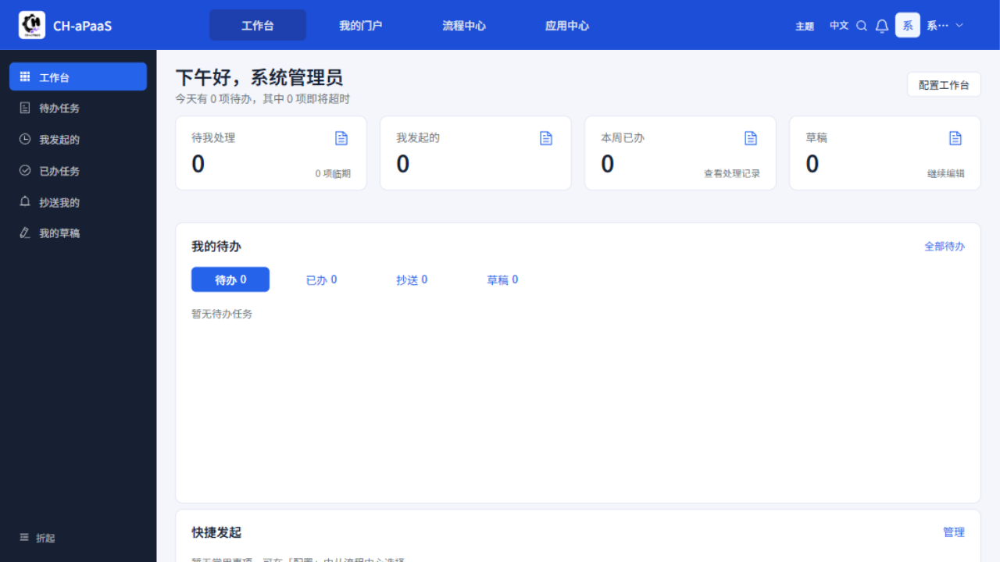
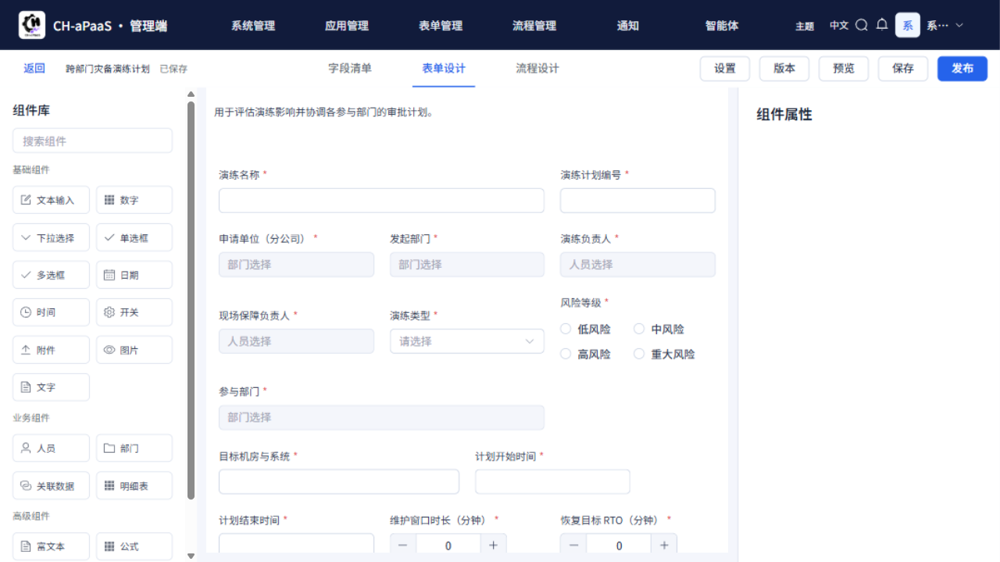
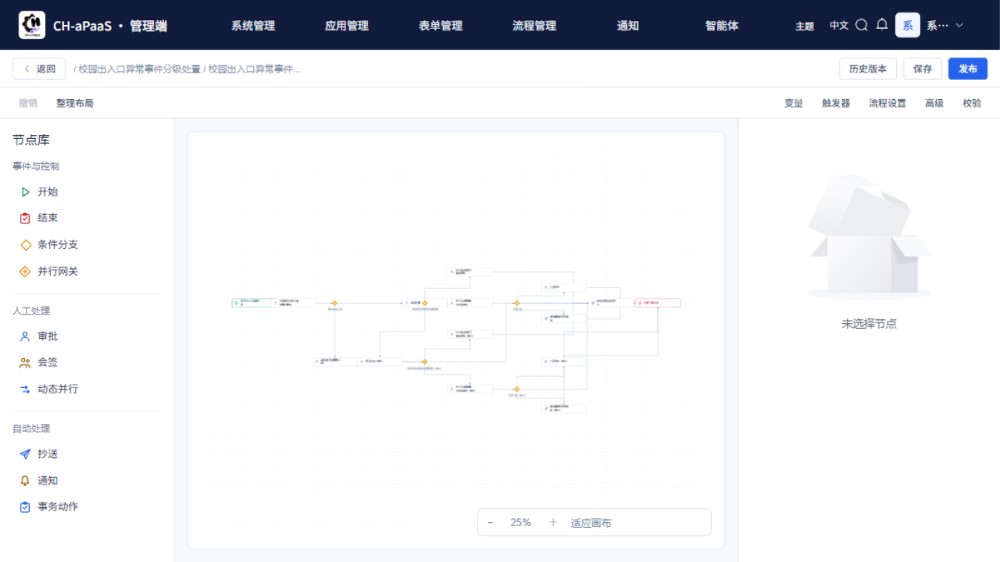
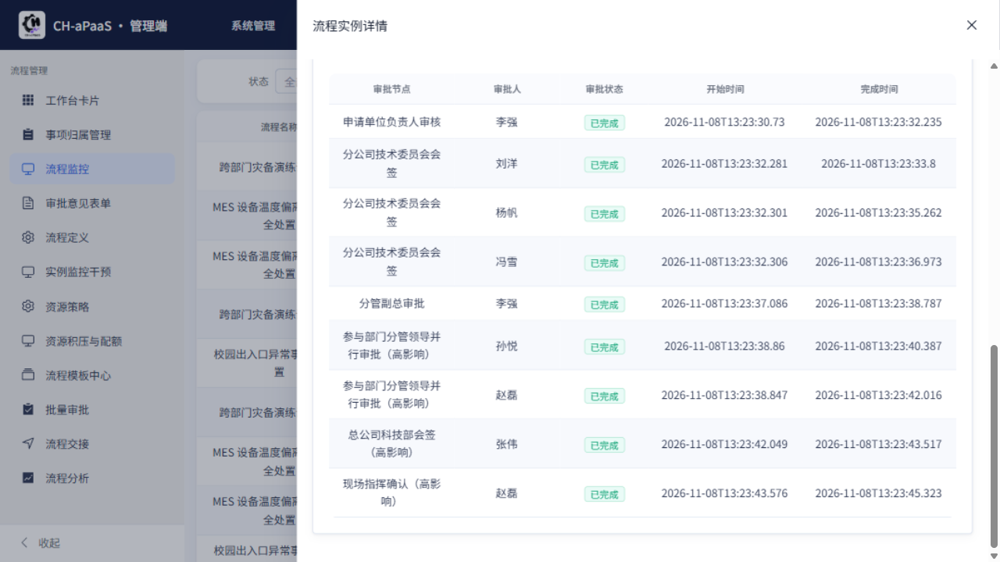
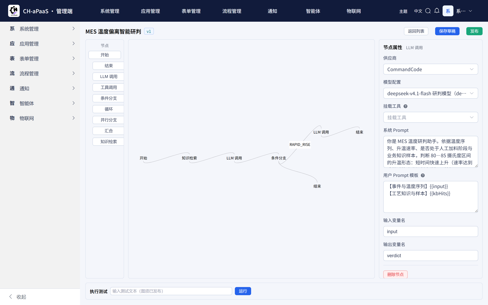
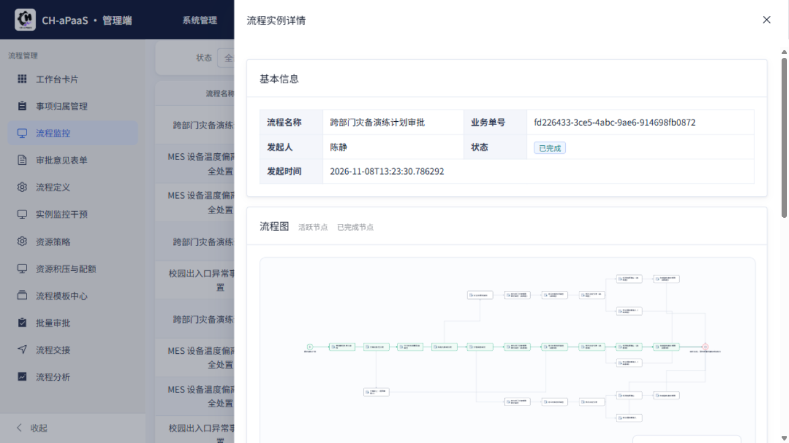
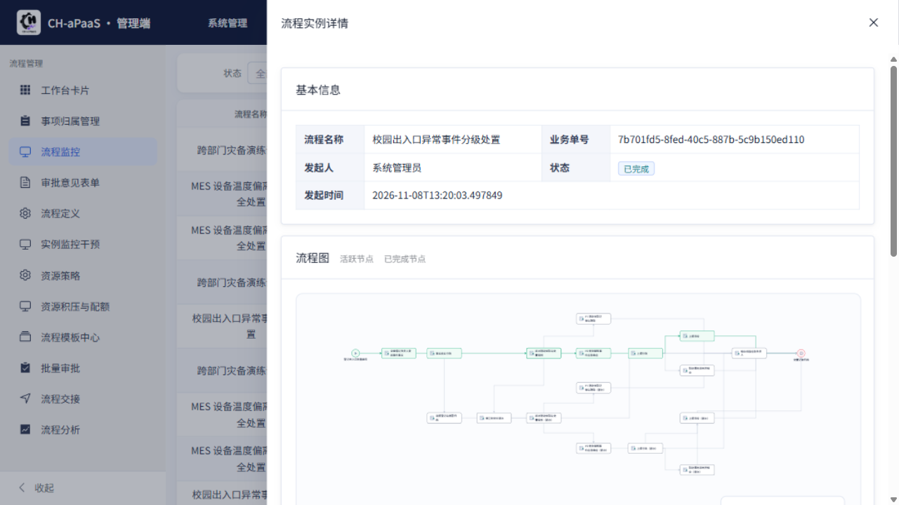
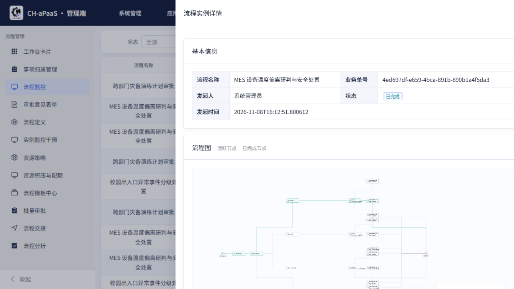
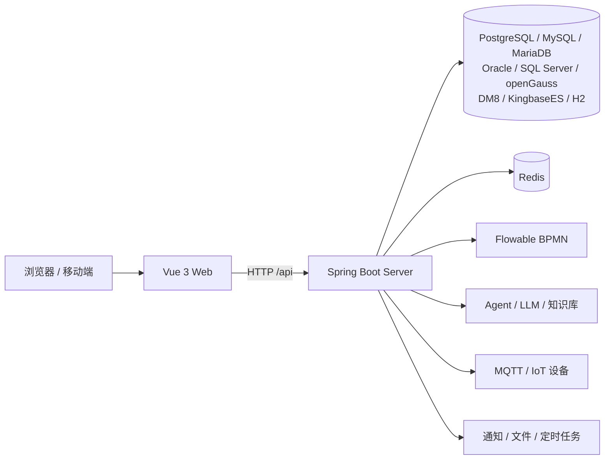

# CH-aPaaS

**企业智能流程与低代码 AI Agent 平台**




CH-aPaaS 以表单和流程为业务主线，把组织权限、通知、任务、文件、设备与智能编排组合在同一套工作流中。项目由三个仓库组成：本仓库负责规划、知识、治理与交付追溯，后端与前端分别独立开发、测试和发布。

- 当前版本：**Server 0.4.0** · **Web 0.3.6**
- 正式功能：**52** 个
- 三示例流程：**已完成（MVP）**
- 数据库：PostgreSQL / MySQL / MariaDB / Oracle / SQL Server / openGauss / DM8 / KingbaseES / H2

## 核心能力

| 能力 | 说明 |
| --- | --- |
| 低代码表单 | 设计、发布、填写、查询业务表单，支持子表、表单引用、动态宽表与版本化定义 |
| 流程自动化 | BPMN 流程定义、发起、审批、会签、条件分支、流程变量与实例监控 |
| 组织与权限 | 多租户、用户/部门/角色/菜单/字典、数据范围与功能权限 |
| 通用业务服务 | 通知、文件存储、定时任务、OpenAPI、审计与幂等 |
| AI Agent 与知识 | 模型/供应商管理、Prompt、图编排、工具调用、知识库与 RAG |
| IoT 接入 | MQTT 设备连接、规则触发、设备指令与审批流程联动 |

## 界面预览

| 表单设计器 | 流程设计器 |
| --- | --- |
|  |  |

| 审批详情与流转记录 | 智能体图编排 |
| --- | --- |
|  |  |

## 三示例流程（已完成）

三条示例流程已达到 MVP，覆盖“表单 → 流程 → 审批 → 业务动作 → Agent/IoT 联动”的完整链路：

| 示例 | 业务场景 | 关键链路 |
| --- | --- | --- |
| A · 应急演练 | 跨部门灾备演练计划审批 | 申请单位负责人 → 技术委员会会签 → 分管副总 → 参与部门并行 → 总公司会签 → 现场指挥 |
| B · 值班协同 | 校园出入口异常事件分级处置 | 安保复核 → 事实核实分流 → 督办/上报/现场处置 → P0/P1 分支 |
| C · MES 异常研判 | MES 设备温度偏离研判与安全处置 | 温度记录 → 班组长确认 → 原因分类 → 校准/维修/工艺调整 → 复产审批 |

| A · 应急演练 | B · 值班协同 | C · MES 异常研判 |
| --- | --- | --- |
|  |  |  |

交付登记与完整验收链路见 [`knowledge/features/0.3.2-opinion-display.md`](knowledge/features/0.3.2-opinion-display.md) 与 [`product/three-sample-process-uat/`](product/three-sample-process-uat/)。

## 架构



## 多数据库支持（0.4.0）

0.4.0 起，同一套迁移与 SQL 种子可在以下数据库上完成空库启动、迁移、种子和业务冒烟：

| 数据库 | 版本 | 验证方式 | 建库前提（摘要） |
| --- | --- | --- | --- |
| H2 | 测试/开发模式 | 既有回归 | 保持现状 |
| PostgreSQL | 14.24（UAT）/ 17.5+（CI） | 实测 | UTF8；UAT 迁移校验和为准 |
| MySQL | 5.7 / 8.0 | 实测 | `utf8mb4` + `utf8mb4_bin`；`explicit_defaults_for_timestamp=ON` |
| MariaDB | 10.6+ | 实测 | `utf8mb4_bin`；`explicit_defaults_for_timestamp=ON` |
| Oracle | 21c XE | 实测 | `AL32UTF8`；空串=NULL 语义 |
| SQL Server | 2019+ / 2022 | 实测 | `Chinese_PRC_CS_AS`；终态基线 |
| openGauss | 5.0 | 实测 | `UTF8` + `DBCOMPATIBILITY 'PG'` |
| DM8 | — | Owner 实库验证 | `CASE_SENSITIVE=Y`、`LENGTH_IN_CHAR=1` |
| KingbaseES | V8 | Owner 实库验证 | `database_mode=pg`（参数名随版本） |

完整建库参数、JDBC 示例、向量存储与 SQL Server 基线说明见
[`docs/deployment/multi-database.md`](Smart-WorkFlow-aPaaS-server/docs/deployment/multi-database.md)。

## 仓库结构

| 仓库 | 职责 | 入口 |
| --- | --- | --- |
| `Smart-WorkFlow-Agent-Workspace`（本仓库） | 规划、方向、回执、知识、记忆与治理 | [`system.md`](system.md) · [`knowledge/`](knowledge/) |
| `Smart-WorkFlow-aPaaS-server` | Java 后端、数据库、认证授权、业务服务与 API | [`README`](Smart-WorkFlow-aPaaS-server/README.md) · [工程宪法](Smart-WorkFlow-aPaaS-server/docs/governance/engineering-constitution.md) |
| `Smart-WorkFlow-aPaaS-Web` | Vue 前端、页面交互、前端架构与 API/Mock | [`README`](Smart-WorkFlow-aPaaS-Web/README.md) · [工程宪法](Smart-WorkFlow-aPaaS-Web/docs/governance/engineering-constitution.md) |

工作区主要目录：

```text
.
├── system.md              # 治理宪法（角色/授权/流程/终态）
├── roles/                 # Planner / Executor / Admin 细则
├── product/               # 方向、回执、证据（按任务分目录）
├── knowledge/             # 架构、当前状态、功能登记
├── memory/                # 精简状态、交接、问题索引
├── todo/                  # 需求池与待办
├── docs/                  # 运维、部署与 UI 文档
├── Smart-WorkFlow-aPaaS-server/
└── Smart-WorkFlow-aPaaS-Web/
```

运行关系：

```text
Smart-WorkFlow-aPaaS-Web (:5173)
        │  HTTP /api
        ▼
Smart-WorkFlow-aPaaS-server (:8080/api)
        ├── PostgreSQL / MySQL / MariaDB / Oracle / SQL Server / openGauss / DM8 / KingbaseES / H2
        └── Redis
```

## 快速开始

### 1. 克隆工作区

本示例实例在 `develop-sw` 分支；远端默认 `main` 是通用 Engine 基线，不含本项目业务内容。

```bash
git clone --branch develop-sw git@github.com:Chikaaho/Smart-WorkFlow-Agent-Workspace.git
cd Smart-WorkFlow-Agent-Workspace
```

### 2. 克隆后端与前端

```bash
git clone git@github.com:Chikaaho/Smart-WorkFlow-aPaaS-server.git Smart-WorkFlow-aPaaS-server
git clone git@github.com:Chikaaho/Smart-WorkFlow-aPaaS-Web.git Smart-WorkFlow-aPaaS-Web
```

### 3. 启动与验证

- 后端：JDK 21、Maven 3.9+；按 [`server README`](Smart-WorkFlow-aPaaS-server/README.md) 配置数据源与 Redis 后启动。
- 前端：Node.js 20+、pnpm；按 [`web README`](Smart-WorkFlow-aPaaS-Web/README.md) 安装依赖并启动开发服务器。
- 数据库建库前提与多库连接示例见 [`multi-database.md`](Smart-WorkFlow-aPaaS-server/docs/deployment/multi-database.md)。
- 开发命令与环境准备见 [`knowledge/development-workflow.md`](knowledge/development-workflow.md)。

## 版本与发布

当前正式版本：

- **Server 0.4.0**：tag `0.4.0`=`a4f6c278`，Release `438918154`，
  `bootstrap-0.4.0.jar` 236,245,457 B sha256 `188be963…`；
  UAT `build.version=0.4.0`、health UP、Flyway `v0.4.0`。
- **Web 0.3.6**：tag `0.3.6`=`c3f1d6e`，Release `438126185`，
  `sw-web-dist-0.3.6.zip` 6,197,059 B sha256 `9470f0c1…`；
  UAT 入口 `assets/index-CKdiXkhU.js`。

发布说明与历史版本见 [`CHANGELOG.md`](CHANGELOG.md)；0.4.0 执行回执见
[`execution-final-03.md`](product/multi-database-compat/receipts/execution-final-03.md)。

## 开发与治理

本项目按任务风险分级：

| 等级 | 典型任务 | 工作方式 |
| --- | --- | --- |
| S | 文案、局部 CSS、低风险修正 | Executor 直接修改并聚焦验证 |
| M | 单模块小功能、局部接口/流程调整 | 简版 Plan → Execute → Test |
| L | 新模块、跨仓、重要流程、正式功能 | Planner 方向 → Executor 实现与证据 → Planner 验收与终态同步 |
| XL | 核心架构、多版本演进、重大迁移 | L 级闭环 + Decision Records + 分阶段验收 |

- 交付生命周期、角色与授权：[`system.md`](system.md)
- 角色细则：[`roles/`](roles/)
- 后端工程规范：[`engineering-constitution.md`](Smart-WorkFlow-aPaaS-server/docs/governance/engineering-constitution.md)
- 前端工程规范：[`engineering-constitution.md`](Smart-WorkFlow-aPaaS-Web/docs/governance/engineering-constitution.md)

## 文档导航

| 主题 | 文档 |
| --- | --- |
| 治理入口 | [`system.md`](system.md) |
| 整体架构 | [`knowledge/architecture.md`](knowledge/architecture.md) |
| 当前状态 | [`knowledge/current-status.md`](knowledge/current-status.md) |
| 功能登记 | [`knowledge/features/`](knowledge/features/) |
| 发布说明 | [`CHANGELOG.md`](CHANGELOG.md) |
| 多数据库部署 | [`multi-database.md`](Smart-WorkFlow-aPaaS-server/docs/deployment/multi-database.md) |
| 生产运维 | [`production-ops.md`](docs/ops/production-ops.md) |
| 方向与回执 | [`product/`](product/) |
| 需求池 | [`todo/requirement-pool.md`](todo/requirement-pool.md) |

## 关于示例分支

本仓库 `develop-sw` 是 **Agent Coding Engine** 的 CH-aPaaS 示例实例，保留本项目的完整状态、知识、记忆、方向、回执与追溯关系；Engine 通用默认分支为 `main`，不含本实例业务事实。`memory/`、`knowledge/`、`product/`、`todo/`、`search_task/`、`search_fallback/` 均为实例私有内容，不反向复制回 Engine 默认分支。

## 许可证与致谢

本仓库为 CH-aPaaS 示例实例，当前未附带开源许可证；对外使用、分发或再发布前请先与 Owner 确认。

项目基于 Java 21 / Spring Boot、Vue 3 / Vite、Flowable、MyBatis-Plus、LangChain4j、Element Plus 等开源组件构建；数据库驱动与镜像遵循各自许可证。感谢所有上游项目与贡献者。
