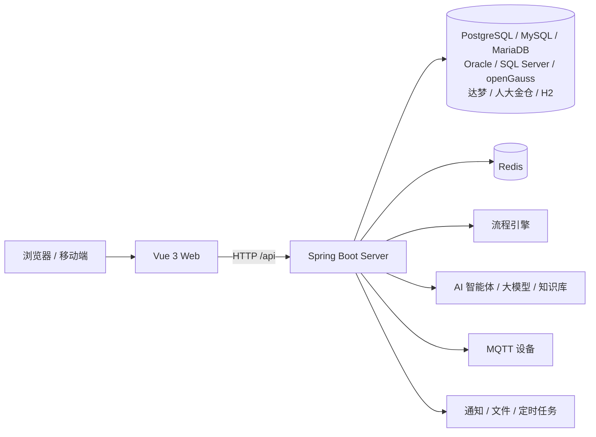

# CH-aPaaS

**企业智能流程与低代码 AI Agent 平台**


CH-aPaaS 是一个可以自己搭建业务应用的低代码平台：把业务做成表单和流程，就能在工作台上发起、审批和跟进；在这个基础上，还带 AI 智能体、设备接入和消息通知。项目由三部分组成：本仓库放规划文档和开发治理资料，[后端](https://github.com/Chikaaho/Smart-WorkFlow-aPaaS-server)和[前端](https://github.com/Chikaaho/Smart-WorkFlow-aPaaS-Web)分别独立开发、发布。

- 当前版本：**Server 0.4.0** · **Web 0.3.6**
- 数据库：PostgreSQL / MySQL / MariaDB / Oracle / SQL Server / openGauss / 达梦 / 人大金仓 / H2

## 核心能力

| 能力 | 说明 |
| --- | --- |
| 低代码表单 | 拖拽设计业务表单，支持附件、图片、子表和显示联动，发布后即可填报 |
| 流程审批 | 会签、条件分支、多人并行审批，审批意见可以决定流程走向 |
| AI 智能体 | 图形化编排智能体，接入大模型，能查知识库回答问题、调用工具、自动建单 |
| 设备接入 | 通过 MQTT 控制设备，设备事件可以触发智能体研判和告警 |
| 消息通知 | 站内信、邮件、短信、飞书、钉钉、企业微信统一发送 |
| 组织权限 | 部门、角色、数据权限，支持企业微信、飞书、钉钉单点登录 |

## 界面预览

| 表单设计器 | 流程设计器 |
| --- | --- |
|  |  |

智能体界面的截图将在后续版本补充。

## 三个示例流程

三个完整的示例业务，全部可以在演示环境里走通「填表 → 审批 → 自动执行」的全过程：

| 示例 | 业务场景 | 关键链路 |
| --- | --- | --- |
| 应急演练 | 跨部门灾备演练计划审批 | 多轮会签 → 各部门并行审批 → 到点自动下发设备指令 |
| 校园门岗异常 | 校园出入口异常事件分级处置 | AI 研判原因 → 按严重程度建单 → 督办/上报/现场处理 |
| 设备温度监控 | 设备温度偏离的智能研判与处置 | AI 按阈值研判 → 自动建单 → 校准/维修 → 复产审批 |

| 应急演练 | 校园门岗异常 | 设备温度监控 |
| --- | --- | --- |
|  |  |  |

## 架构



## 支持的数据库

| 数据库 | 版本 | 建库要求 |
| --- | --- | --- |
| PostgreSQL | 14+ | UTF8；知识库功能需要 pgvector 扩展 |
| MySQL | 5.7 / 8.0 | `utf8mb4` + `utf8mb4_bin`；`explicit_defaults_for_timestamp=ON` |
| MariaDB | 10.6+ | `utf8mb4` + `utf8mb4_bin`；`explicit_defaults_for_timestamp=ON` |
| Oracle | 21c | `AL32UTF8` |
| SQL Server | 2019+ | 排序规则 `Chinese_PRC_CS_AS` |
| openGauss | 5.0 | `UTF8` + `DBCOMPATIBILITY 'PG'` |
| 达梦 DM8 | 8 | `CASE_SENSITIVE=Y`、`LENGTH_IN_CHAR=1` |
| 人大金仓 KingbaseES | V8 | 兼容模式 `pg`（参数名随版本） |

> PostgreSQL、MySQL、MariaDB、Oracle、SQL Server、openGauss 已测试；达梦、人大金仓未测试（欢迎反馈）。

各库的完整建库参数和连接示例见
[多数据库部署说明](https://github.com/Chikaaho/Smart-WorkFlow-aPaaS-server/blob/main/docs/deployment/multi-database.md)。

## 仓库结构

| 仓库 | 职责 | 入口 |
| --- | --- | --- |
| `Smart-WorkFlow-Agent-Workspace`（本仓库） | 规划文档、知识与开发治理资料 | [`system.md`](system.md) · [`knowledge/`](knowledge/) |
| `Smart-WorkFlow-aPaaS-server` | Java 后端、数据库、业务服务与 API | [`README`](https://github.com/Chikaaho/Smart-WorkFlow-aPaaS-server/blob/main/README.md) · [工程宪法](https://github.com/Chikaaho/Smart-WorkFlow-aPaaS-server/blob/main/docs/governance/engineering-constitution.md) |
| `Smart-WorkFlow-aPaaS-Web` | Vue 前端、页面交互与管理界面 | [`README`](https://github.com/Chikaaho/Smart-WorkFlow-aPaaS-Web/blob/main/README.md) · [工程宪法](https://github.com/Chikaaho/Smart-WorkFlow-aPaaS-Web/blob/main/docs/governance/engineering-constitution.md) |

```text
.
├── system.md              # 治理宪法（角色/授权/流程）
├── roles/                 # 角色细则
├── product/               # 任务过程与记录（按任务分目录）
├── knowledge/             # 架构、当前状态、功能登记
├── memory/                # 精简状态与交接
├── todo/                  # 需求池与待办
├── docs/                  # 运维、部署与 UI 文档
├── Smart-WorkFlow-aPaaS-server/   # 后端（独立仓库，见上文链接）
└── Smart-WorkFlow-aPaaS-Web/      # 前端（独立仓库，见上文链接）
```

运行关系：

```text
Smart-WorkFlow-aPaaS-Web (:5173)
        │  HTTP /api
        ▼
Smart-WorkFlow-aPaaS-server (:8080/api)
        ├── PostgreSQL / MySQL / MariaDB / Oracle / SQL Server / openGauss / 达梦 / 人大金仓 / H2
        └── Redis
```

## 快速开始

### 1. 克隆本仓库（规划文档）

```bash
git clone --branch develop-sw git@github.com:Chikaaho/Smart-WorkFlow-Agent-Workspace.git
cd Smart-WorkFlow-Agent-Workspace
```

### 2. 克隆后端与前端

```bash
git clone git@github.com:Chikaaho/Smart-WorkFlow-aPaaS-server.git Smart-WorkFlow-aPaaS-server
git clone git@github.com:Chikaaho/Smart-WorkFlow-aPaaS-Web.git Smart-WorkFlow-aPaaS-Web
```

### 3. 启动

- 后端：JDK 21、Maven 3.9+、PostgreSQL 与 Redis；按 [后端 README · 快速开始](https://github.com/Chikaaho/Smart-WorkFlow-aPaaS-server/blob/main/README.md#快速开始) 构建并启动。
- 前端：Node.js 20+、pnpm 9+；按 [前端 README · 快速开始](https://github.com/Chikaaho/Smart-WorkFlow-aPaaS-Web/blob/main/README.md#快速开始) 安装依赖并启动。
- 数据库建库参数与连接示例见[多数据库部署说明](https://github.com/Chikaaho/Smart-WorkFlow-aPaaS-server/blob/main/docs/deployment/multi-database.md)。

## 版本

当前版本 **Server 0.4.0** · **Web 0.3.6**（两者搭配使用）。

历史版本与下载见 [后端 Releases](https://github.com/Chikaaho/Smart-WorkFlow-aPaaS-server/releases)、[前端 Releases](https://github.com/Chikaaho/Smart-WorkFlow-aPaaS-Web/releases) 与 [`CHANGELOG.md`](CHANGELOG.md)。

## 开发与治理

本仓库用「规划 → 执行 → 检查」的固定流程管理开发：每个任务先由规划角色写清目标和完成标准，执行角色实现并留下记录，再由规划角色逐项复核后关闭；全程记录都在 `product/` 和 `knowledge/` 里。角色分工见 [`system.md`](system.md) 与 [`roles/`](roles/)；后端与前端的工程规范见各自仓库的工程宪法。

## 文档导航

| 主题 | 文档 |
| --- | --- |
| 治理入口 | [`system.md`](system.md) |
| 整体架构 | [`knowledge/architecture.md`](knowledge/architecture.md) |
| 当前状态 | [`knowledge/current-status.md`](knowledge/current-status.md) |
| 功能登记 | [`knowledge/features/`](knowledge/features/) |
| 发布说明 | [`CHANGELOG.md`](CHANGELOG.md) |
| 多数据库部署 | [multi-database.md](https://github.com/Chikaaho/Smart-WorkFlow-aPaaS-server/blob/main/docs/deployment/multi-database.md) |
| 生产运维 | [`production-ops.md`](docs/ops/production-ops.md) |
| 任务记录 | [`product/`](product/) |
| 需求池 | [`todo/requirement-pool.md`](todo/requirement-pool.md) |

## 关于分支

本仓库 `develop-sw` 分支是 **Agent Coding Engine** 的 CH-aPaaS 示例实例，保留本项目的完整状态、知识、记忆与任务记录；通用默认分支为 `main`，不含本实例的业务内容。

## 许可证与致谢

本项目当前未附带开源许可证；对外使用、分发或再发布前请先联系作者。

基于 Java 21 / Spring Boot、Vue 3 / Vite、Flowable、MyBatis-Plus、LangChain4j、Element Plus 等开源组件构建；数据库驱动与镜像遵循各自许可证。感谢所有上游项目与贡献者。
